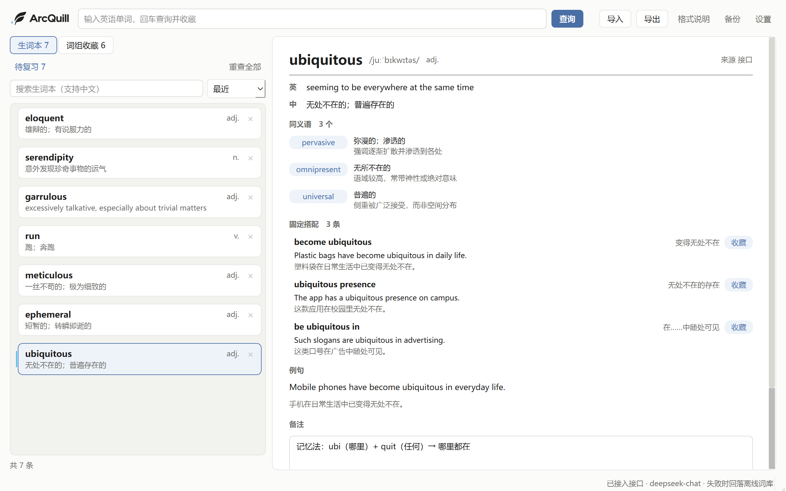
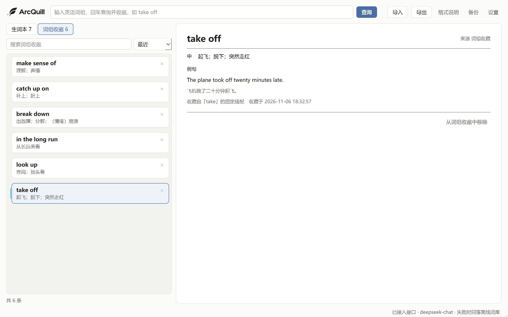
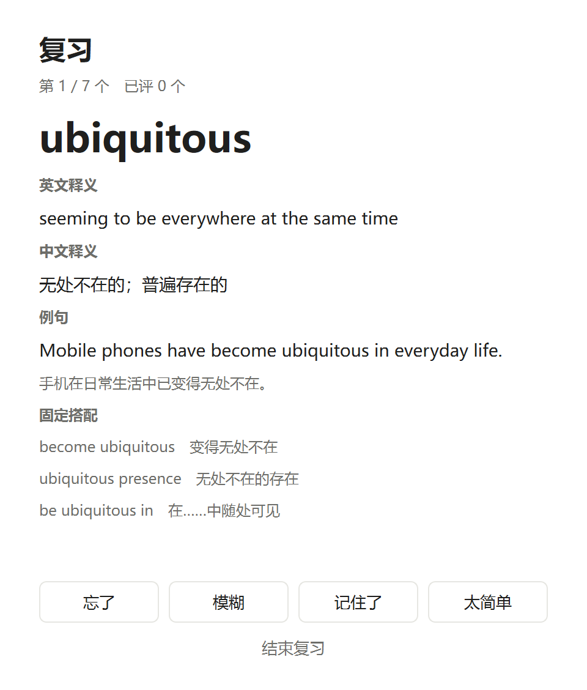
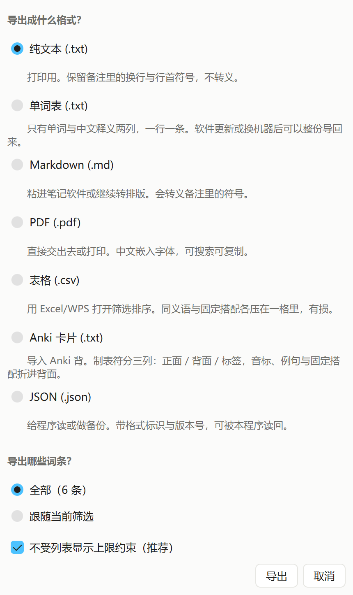
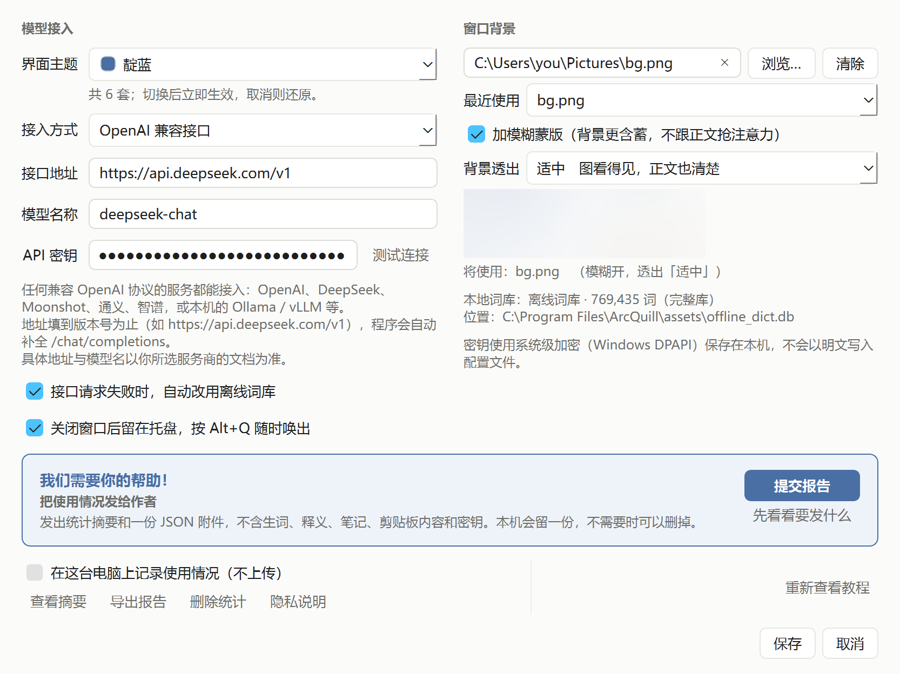
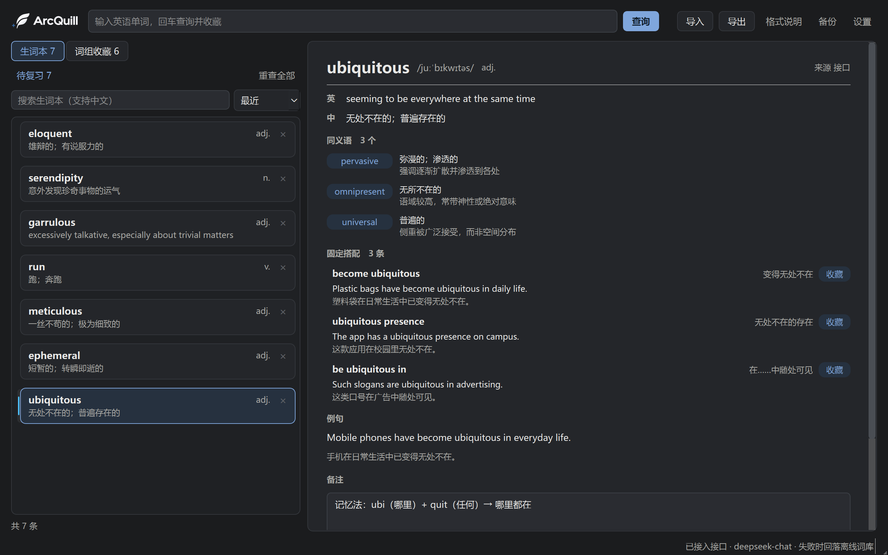

# ArcQuill

  简体中文 · <a href="README.zh-CN.md">English</a>

### Every word is a new discovery.

**A local-first vocabulary notebook for English learners.**

ArcQuill helps you turn unfamiliar words into lasting knowledge. Look up words, collect useful expressions, explore meanings with optional AI assistance, and revisit your vocabulary through spaced repetition.

Built for curious minds, deep readers, and anyone who wants to make every word count.

> [!NOTE]
> ArcQuill is a Windows desktop application. Check the latest release for the current download and system requirements.

  <a href="https://github.com/whitede22/ArcQuill/releases">Download for Windows</a> ·
  <a href="#-getting-started">Getting Started</a> ·
  <a href="#-features">Features</a>

---

## ✨ Features

### 📖 Look up words
- Search words with a local dictionary.
- Look up vocabulary without depending on an online dictionary service.
- Quickly access word definitions and build your personal vocabulary collection.

### 🪶 Build your own vocabulary
- Save words and useful expressions as you encounter them.
- Organize your collection with tags and search.
- Import and export vocabulary in supported formats.
- Keep your learning materials under your own control.

### 🔮 Understand words in context
- Explore collocations and distinctions between similar words.
- Get Chinese explanations with optional AI assistance.
- Use your own API key to access supported AI services.

*AI features require additional configuration and may incur charges from your chosen provider.*

### 🧠 Remember what you learn
- Review saved vocabulary with spaced repetition.
- Use a four-grade review system to track how well you remember words.
- Turn occasional lookups into a sustainable learning habit.

### 🛡️ Keep your workflow local
- Use the local dictionary without requiring an AI service.
- Back up and restore your vocabulary data using supported features.
- Access optional usage statistics to better understand your learning and application performance.

*Network access and data handling depend on the feature you use. See [Privacy and Data](#-privacy-and-data) for details.*

---

## 🚀 Getting Started

### 1. Download

Visit the [Releases page](https://github.com/whitede22/ArcQuill/releases) and download the latest Windows release.

### 2. Extract and launch

Extract the downloaded archive and launch the application using the executable included in the release package.

If Windows displays a security warning, verify that the file came from the official release before deciding whether to run it.

### 3. Look up your first word

Search for a word you recently encountered while reading. Save it if you want to remember it, and revisit it later through vocabulary review.

### 4. Explore optional features

Once you're comfortable with the basic workflow, explore vocabulary organization, spaced repetition, and AI-assisted explanations.

You can use the core dictionary workflow without configuring an AI API key.

---

## 🖼️ Screenshots

  

The lookup view. Definitions, sense differences, collocations and examples share one screen, with a notes column on the right.

  

Phrase mode. Expressions saved while reading sit in their own list, linked back to the word they came from.

  

A review card after flipping. Four grades decide when the word comes back.

  

Export to plain text, word list, Markdown, PDF, CSV, Anki or JSON, scoped to everything or to one tag.

  

Settings. Endpoint, key, background image and usage statistics live on this page.

  

The dark theme. Same layout, different palette, and the wordmark follows.

---

## 🧰 Technology

ArcQuill is a Windows desktop application built with Python and Qt for its graphical interface.

The application is designed to combine local vocabulary management with optional online capabilities.

*Additional technical details and development instructions can be documented here as the project evolves.*

---

## 🔒 Privacy and Data

Your vocabulary collection is an important part of your learning history.

ArcQuill provides local vocabulary storage and backup capabilities. Some optional features may communicate with external services.

Before enabling online or AI-assisted features, please review the following:

- **Local data:** Confirm the location of vocabulary, settings, and backup files in the application documentation.
- **AI requests:** Your selected provider may receive the information submitted for an AI request.
- **Usage statistics:** Review the application's settings and documentation to understand which statistics are collected and whether any information is transmitted.
- **Backups:** Keep a separate backup of important vocabulary data.

See the project's documentation for the exact data handling behavior of your version.

---

## 🗺️ Roadmap

ArcQuill aims to make vocabulary collection and review easier, faster, and more reliable.

Potential areas for improvement include:

- [ ] A smoother first-launch experience
- [ ] Clearer guidance for new users
- [ ] More efficient vocabulary review
- [ ] Better visibility into learning progress
- [ ] Improved packaging and distribution
- [ ] Further improvements to lookup performance and reliability

This roadmap is a list of development directions, not a guarantee that every item will be implemented.

---

## 🐛 Bug Reports and Feedback

Found a bug or have an idea for improvement?

Please visit the project's [Issues page](https://github.com/whitede22/ArcQuill/issues) to report problems or suggest features.

When reporting a bug, include:

- Your Windows version
- The ArcQuill version you're using
- Steps to reproduce the problem
- Relevant error messages or screenshots

Please avoid including API keys, passwords, or private vocabulary data in public reports.

---

## 📄 License

See [LICENSE](LICENSE) for the project's license and usage terms.

---

  <strong>ArcQuill</strong> 
  <em>Discover a word. Keep its meaning. Make it yours.</em>

