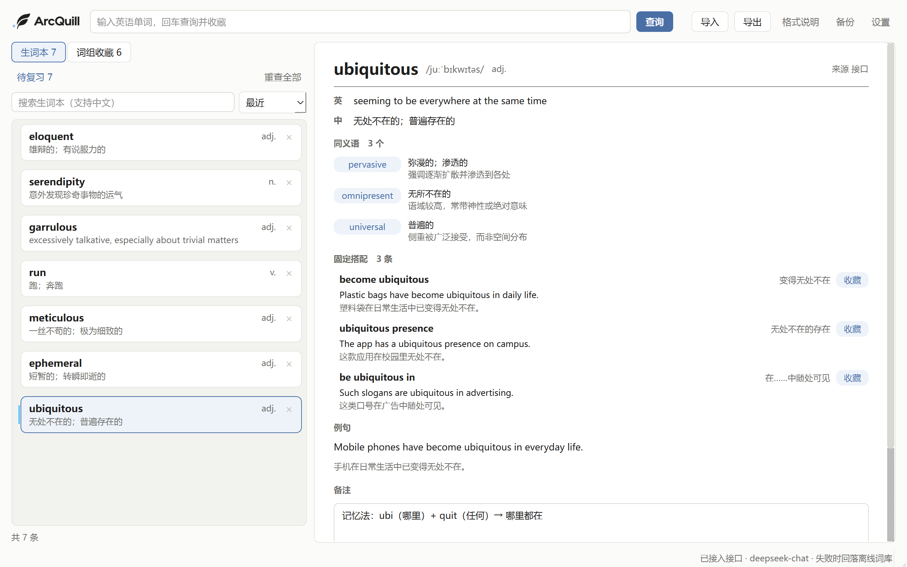
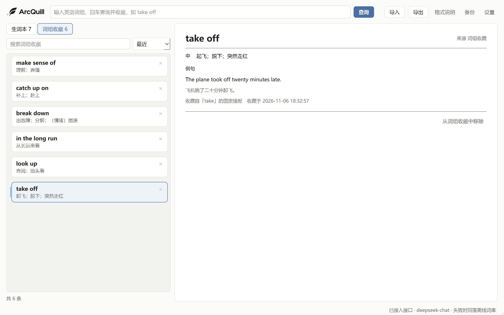
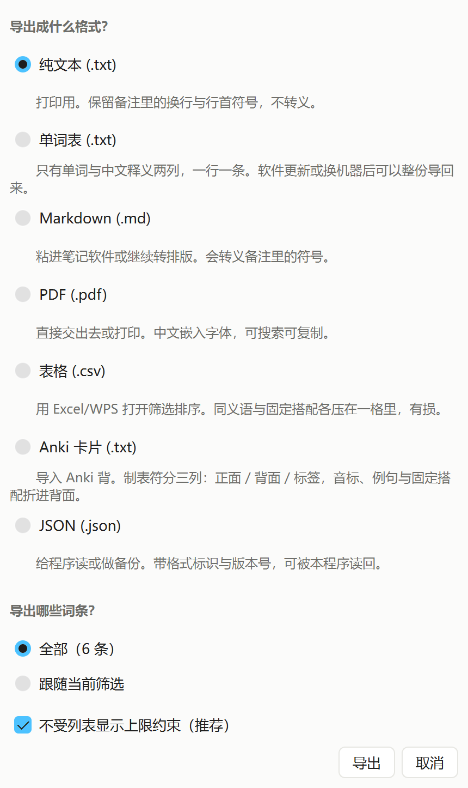
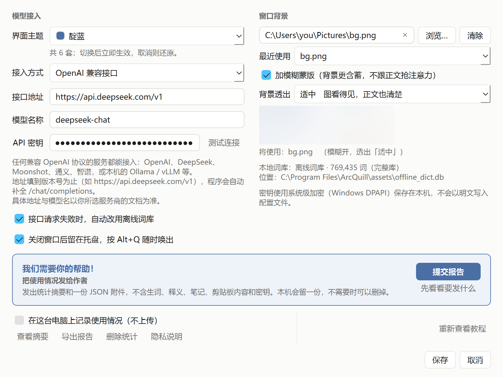
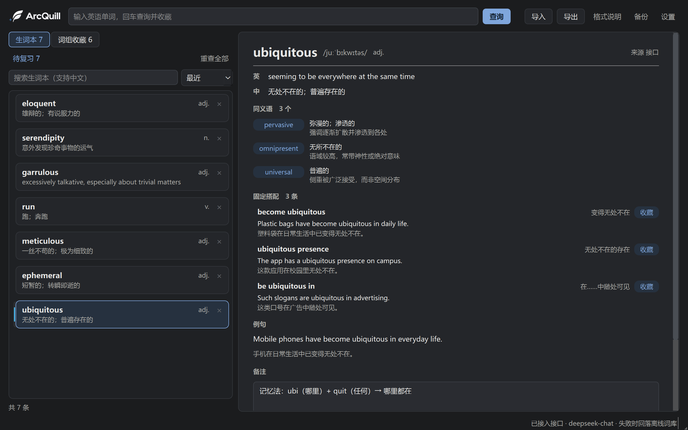

# ArcQuill

  <a href="README.en.md">English</a> · 简体中文

### 每一个单词，都是一次新的发现。

**一款面向英语学习者、以本地数据为核心的生词本。**

ArcQuill 帮助你将阅读中遇到的陌生单词，转化为真正掌握的知识。查找生词、收集实用表达、借助 AI 深入理解词义，并通过间隔复习，让学过的单词真正留在记忆中。

为好奇的探索者、深度阅读者，以及每一个认真对待词汇的人而打造。

> [!NOTE]
> ArcQuill 是一款 Windows 桌面应用。请前往最新发布页面查看当前版本的下载文件与系统要求。

  <a href="https://github.com/whitede22/ArcQuill/releases">下载 Windows 版本</a> ·
  <a href="#-快速开始">快速开始</a> ·
  <a href="#-功能特性">功能特性</a>

---

## ✨ 功能特性

### 📖 快速查词
- 使用本地词典查询单词。
- 无需依赖在线词典服务即可进行离线查词。
- 查询词义，并将值得学习的单词加入个人词库。

### 🪶 构建自己的词库
- 随时收集阅读中遇到的单词与实用表达。
- 通过标签和搜索整理个人词库。
- 使用支持的格式导入和导出词汇。
- 将学习资料掌握在自己手中。

### 🔮 深入理解词义
- 探索常见搭配，理解近义词之间的区别。
- 借助可选的 AI 功能获取中文解释。
- 使用自己的 API Key 接入受支持的 AI 服务。

*AI 功能需要额外配置，使用费用可能由你选择的服务提供商收取。*

### 🧠 让学过的单词真正留下来
- 通过间隔重复机制复习已保存的词汇。
- 使用四级评分机制记录每次复习的记忆情况。
- 将零散的查词行为，逐渐变成可持续的学习习惯。

### 🛡️ 以本地使用为核心
- 无需配置 AI 服务即可使用本地词典。
- 使用应用提供的数据备份与恢复功能。
- 通过可选的使用统计，更好地了解学习情况与应用运行表现。

*具体联网行为与数据处理方式取决于所使用的功能。详情请参阅[隐私与数据](#-隐私与数据)。*

---

## 🚀 快速开始

### 1. 下载

前往 [Releases 发布页面](https://github.com/whitede22/ArcQuill/releases)，下载最新的 Windows 版本。

### 2. 解压并启动

解压下载的压缩包，并运行其中提供的应用程序。

如果 Windows 显示安全警告，请先确认文件来自项目的官方发布页面，再决定是否运行。

### 3. 查询你的第一个单词

输入最近阅读时遇到的生词，查看词义。如果希望之后再次学习，可以将它保存到个人词库，并在后续复习中重新接触。

### 4. 探索更多功能

熟悉基本操作后，可以进一步体验词汇整理、间隔复习和 AI 辅助解释等功能。

基本的本地词典查询流程无需配置 AI API Key。

---

## 🖼️ 软件截图

  

查词页。释义、同义语差别、固定搭配与例句在同一屏，右栏可以写自己的备注。

  

词组模式。阅读中遇到的短语单独收在一处，与它出自的那个词关联。

  

复习翻面后给出释义与例句，四档评分决定它下次出现的时间。

  

导出可选纯文本、单词表、Markdown、PDF、CSV、Anki 与 JSON，范围按全部或当前标签。

  

设置页。接口、密钥、背景图与使用统计都在这一页。

  

深色主题。同一套版式换色，左上角字标跟着换。

---

## 🧰 技术栈

ArcQuill 是一款基于 Python 与 Qt 图形界面技术构建的 Windows 桌面应用。

项目旨在将本地词汇管理与可选的在线能力结合起来。

*随着项目发展，可以在此补充详细的技术架构与开发指南。*

---

## 🔒 隐私与数据

个人词库记录着你的学习历程，值得认真对待。

ArcQuill 提供本地词汇存储与备份能力，部分可选功能可能会与外部服务通信。

在启用联网或 AI 功能之前，请了解以下事项：

- **本地数据：** 请查阅应用文档，确认词汇、设置与备份文件的实际存储位置。
- **AI 请求：** 你选择的服务提供商可能会接收提交给 AI 功能的信息。
- **使用统计：** 请通过应用设置与文档了解统计信息的收集范围，以及是否会向外部传输。
- **数据备份：** 请为重要的词汇数据保留独立备份。

有关具体的数据处理行为，请以对应版本的项目文档为准。

---

## 🗺️ 开发路线图

ArcQuill 希望让词汇收集与复习变得更加轻松、高效、可靠。

未来可能探索的改进方向包括：

- [ ] 优化首次启动与初次使用体验
- [ ] 为新用户提供更清晰的操作指引
- [ ] 提升词汇复习流程的效率
- [ ] 更直观地展示学习进度
- [ ] 改进应用打包与分发体验
- [ ] 持续优化查词速度与运行稳定性

以上为潜在的开发方向，并不代表所有项目都会实施。

---

## 🐛 问题反馈

发现 Bug，或者有改进建议？

欢迎前往项目的 [Issues 页面](https://github.com/whitede22/ArcQuill/issues) 提交问题或提出功能建议。

提交 Bug 时，建议提供：

- Windows 版本
- 当前使用的 ArcQuill 版本
- 问题的复现步骤
- 相关错误信息或截图

请勿在公开反馈中包含 API Key、密码或私人词汇数据。

---

## 📄 开源许可

有关项目的使用与分发条款，请参阅 [LICENSE](LICENSE)。

---

  <strong>ArcQuill</strong> 
  <em>发现一个单词，理解它的含义，让它真正属于你。</em>

